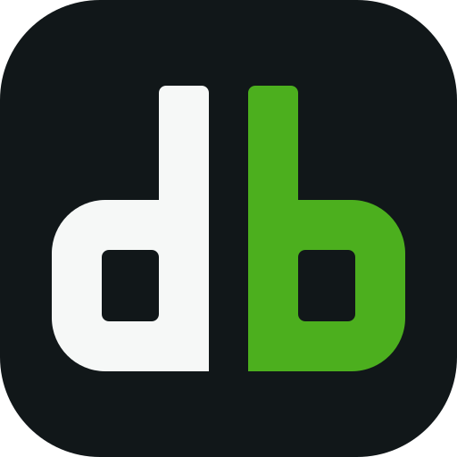

<p align="center">
  
</p>

<h1 align="center">dbee</h1>

<p align="center">
  <b>A desktop database client: an open-source, clean-room take on Beekeeper Studio, built in pure Rust.</b>
</p>

<p align="center">
  
  
</p>

> [!NOTE]
> dbee is pre-alpha: this repository is its scaffold. The app opens an empty window; features start with the first milestone.

## Why dbee

- **Native and fast.** One Rust codebase, no Electron and no browser engine. It runs natively on macOS, Windows, Linux and FreeBSD.
- **Open source.** Dual-licensed MIT or Apache-2.0, written clean-room from public specifications and black-box observation.
- **Scriptable.** Every action is a command that can be run from the CLI, an MCP server or a JSON control channel (all planned, see below).

## Quick start

```sh
cargo run -p dbee                       # the desktop app
cargo run -p dbee-cli -- --version      # the command-line tool
cargo xtask ci                          # fmt, clippy, tests, assets, layering, provenance
```

The app writes its log to `<settings dir>/logs/dbee.log`, where the settings dir is `~/.config/dbee` on Linux and BSD, `~/Library/Application Support/dbee` on macOS and `%APPDATA%\dbee` on Windows.

## For agents: MCP, CLI and the control channel

Everything dbee does is meant to be a command that agents can reach through an MCP server, the CLI and a JSON control channel. None of these exist yet; they are planned and documented first. Start with [`AGENTS.md`](AGENTS.md), then see [`docs/mcp.md`](docs/mcp.md), [`docs/cli.md`](docs/cli.md) and [`docs/control-protocol.md`](docs/control-protocol.md) (all planned).

## Architecture

dbee is an engine-first Cargo workspace with enforced layering (`cargo xtask layers`): domain crates (L0–L4) → `engine` (L5) → `ui-egui` / `mcp` (L6) → `apps/*` (L7). Nothing below L6 depends on the UI toolkit, so the UI crate can be swapped. See [`docs/architecture.md`](docs/architecture.md).

## Roadmap

dbee is **pre-alpha**. Stage, numbers and progress log are in [`ROADMAP.md`](ROADMAP.md).

## Downloads

Builds will appear at https://dbee.rosin.dev and on the [GitHub releases page](https://github.com/KasparRosin/dbee/releases). `<ver>` in the file names is the version number, and `SHA256SUMS.txt` lists a checksum for every file.

### Windows

| Build | Installer | Portable |
|---|---|---|
| x64 (64-bit Intel/AMD) | `dbee-<ver>-windows-x64.msi` | `dbee-<ver>-windows-x64-portable.zip` |
| arm64 (Snapdragon and other ARM PCs) | `dbee-<ver>-windows-arm64.msi` | `dbee-<ver>-windows-arm64-portable.zip` |
| x86 (32-bit) | `dbee-<ver>-windows-x86.msi` | `dbee-<ver>-windows-x86-portable.zip` |

The MSI installer offers an optional desktop shortcut (unchecked on a new installation).

### macOS

| Build | File |
|---|---|
| App, universal (Apple silicon + Intel) | `dbee-<ver>-macos-universal.dmg` |
| Command-line tool, universal | `dbee-cli-<ver>-macos-universal.zip` |

### Linux

| Format | x86_64 | aarch64 (ARM64) | Notes |
|---|---|---|---|
| AppImage | `dbee-<ver>-linux-x86_64.AppImage` | `dbee-<ver>-linux-aarch64.AppImage` | Runs anywhere; updates itself with [AppImageUpdate](https://github.com/AppImageCommunity/AppImageUpdate) (`.zsync` files) |
| Flatpak | `dbee-<ver>-linux-x86_64.flatpak` | `dbee-<ver>-linux-aarch64.flatpak` | Sandboxed; `flatpak install --user <file>` |
| Debian/Ubuntu | `dbee-<ver>-linux-x86_64.deb` | `dbee-<ver>-linux-aarch64.deb` | |
| Fedora/RHEL/openSUSE | `dbee-<ver>-linux-x86_64.rpm` | `dbee-<ver>-linux-aarch64.rpm` | |
| Tarball | `dbee-<ver>-linux-x86_64.tar.gz` | `dbee-<ver>-linux-aarch64.tar.gz` | Unpack anywhere |

### FreeBSD

| Build | File |
|---|---|
| x86_64 | `dbee-<ver>-freebsd-x86_64.tar.gz` |

## License and credits

dbee is dual-licensed under [MIT](LICENSE-MIT) or [Apache-2.0](LICENSE-APACHE), at your option.
Copyright (c) 2026 Kaspar Rosin and the dbee contributors.

Every asset in the repository is listed with its author, source and licence in [ATTRIBUTION.md](ATTRIBUTION.md). The repository holds no font files; the app embeds egui's default fonts (see ATTRIBUTION.md).

<sub>Beekeeper Studio is a trademark of its owner. dbee is an independent project and is not affiliated with or endorsed by it.</sub>
