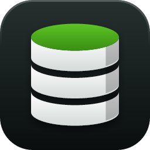
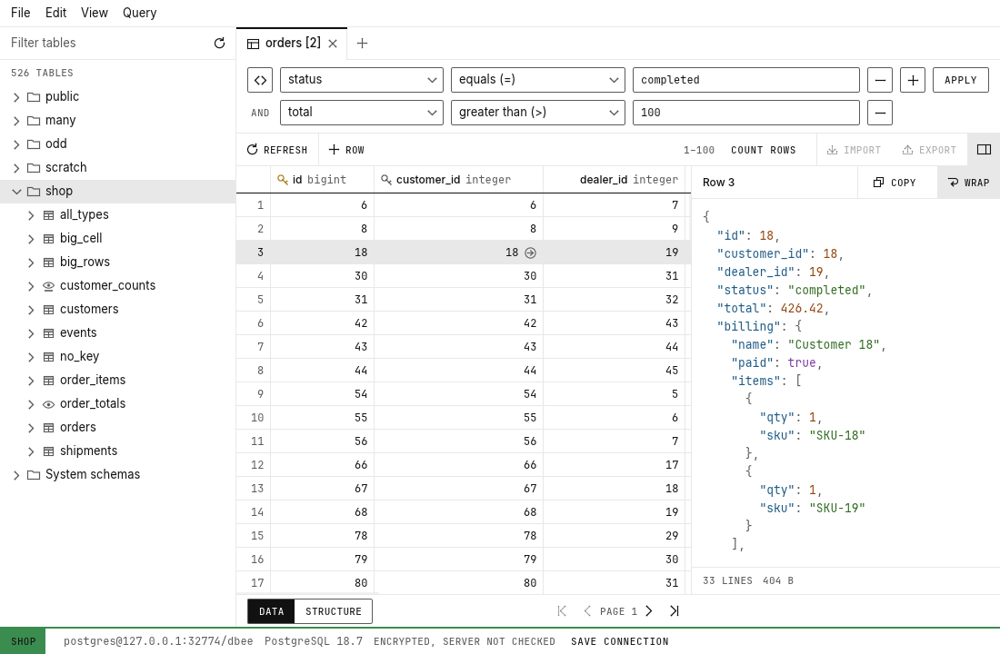

<p align="center">
  
</p>

<h1 align="center">dbee</h1>

<p align="center"><b>A fast, free database client for Linux, macOS and Windows.</b></p>

<p align="center">
  
</p>

## Install

Downloads for Linux, macOS, Windows and FreeBSD are on the [Releases page](https://github.com/KasparRosin/dbee/releases). [docs/installing.md](docs/installing.md) says how to install each one.

## Build from source

You need Rust through [rustup](https://rustup.rs) (`rust-toolchain.toml` picks the toolchain) and a C compiler. On Linux, also the packages that [the CI workflow](.github/workflows/ci.yml) installs.

```sh
cargo run -p dbee    # the desktop app
cargo xtask ci       # every check, before a pull request
```

## More

- [docs/](docs/README.md): every doc, from the architecture to driving dbee from an agent.
- [CONTRIBUTING.md](CONTRIBUTING.md): commit messages and checks. Agents start with [AGENTS.md](AGENTS.md).
- [SECURITY.md](SECURITY.md): reporting a vulnerability, in private.

## License

[MIT](LICENSE-MIT) or [Apache-2.0](LICENSE-APACHE), at your option. Copyright (c) 2026 Kaspar Rosin and the dbee contributors. Every asset's author, source and licence is in [ATTRIBUTION.md](ATTRIBUTION.md).

dbee is inspired by Beekeeper Studio. It is an independent project, not affiliated with or endorsed by Beekeeper Studio, which is a trademark of its owner.
